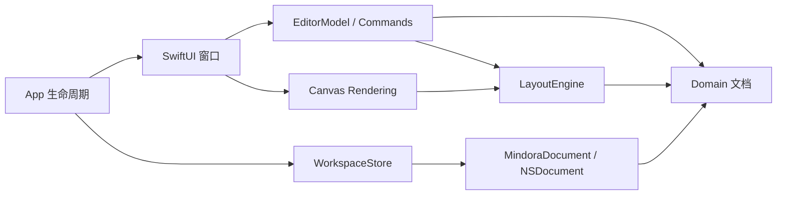
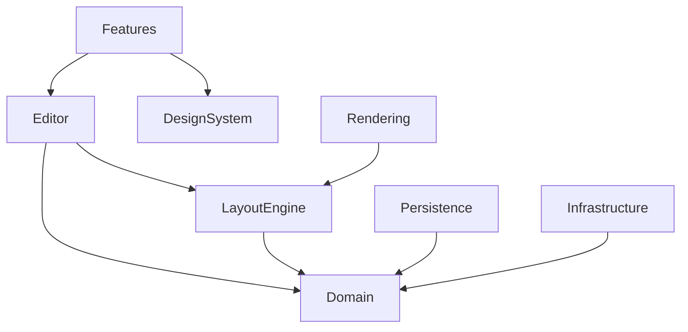
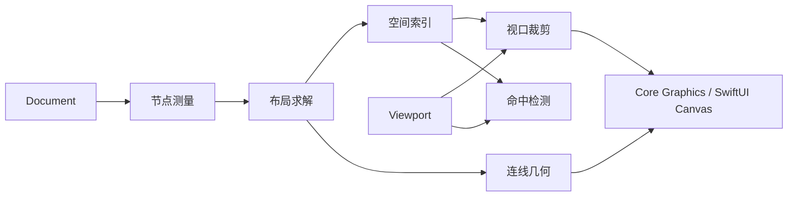
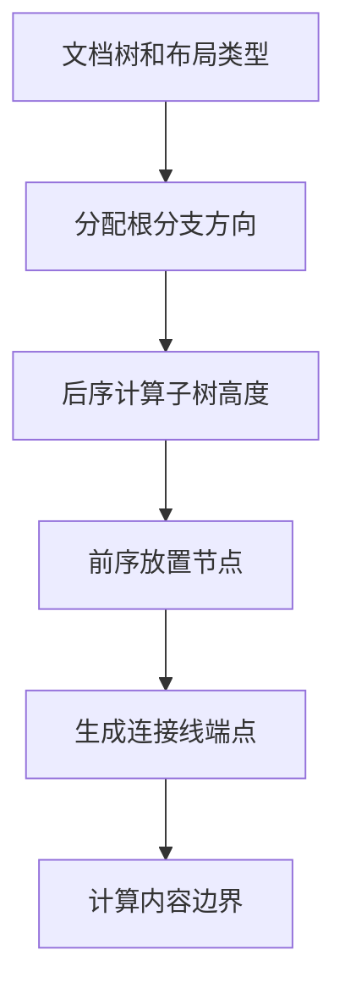
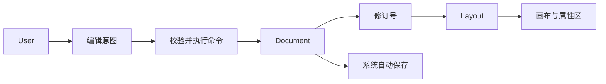
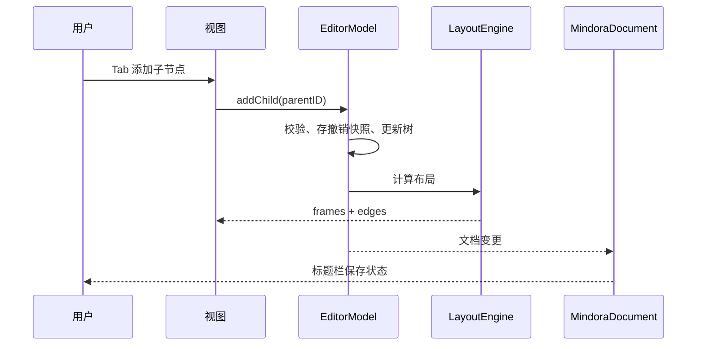
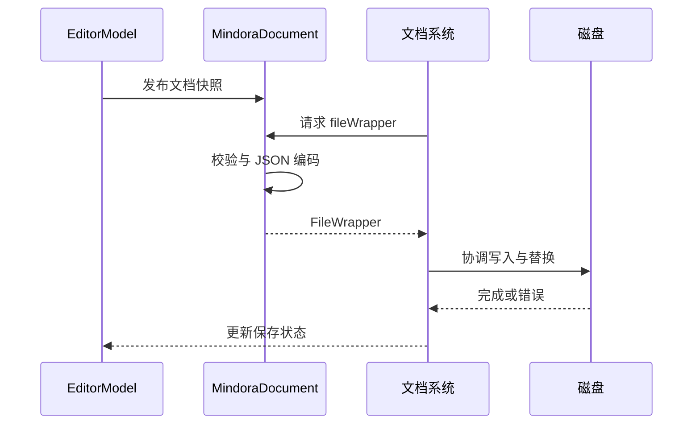
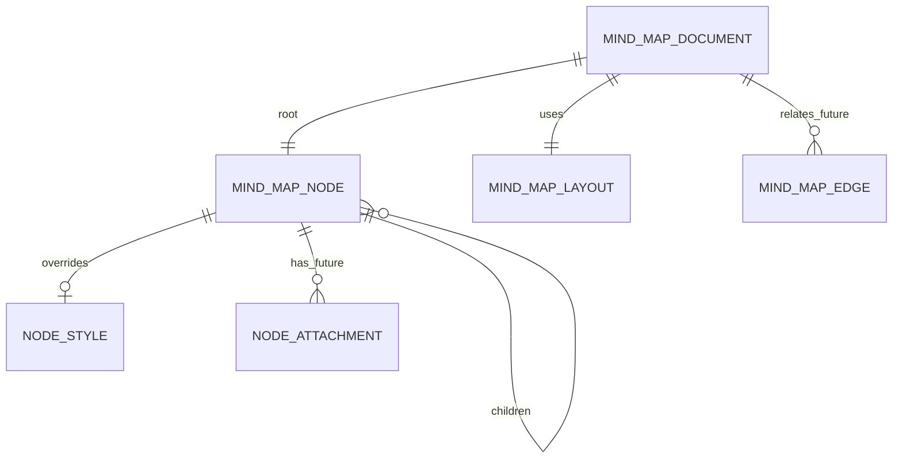

# 系统架构

架构采用轻量 MVVM + 单向编辑命令流。文档领域模型不依赖 UI；编辑器持有瞬时选择与 viewport；布局只消费不可变文档快照；持久化负责校验和编解码。工程为单 App target，SwiftPM 保留开发入口。当前改为单窗口工作台，WorkspaceStore 协调资料库与编辑器切换，详见 docs/20-Single-Window-Workspace.md。

## 总体与依赖

UI 不能直接改树；正式命令系统记录逆操作或文档快照。Canvas 只读布局结果。文件层不依赖布局或 UI。

依赖箭头指向被依赖模块。未来 AI 和同步通过领域用例接口进入，不能直接修改视图状态。

## 画布与布局

当前实现动态节点尺寸与全量布局、可视区域绘制裁剪；空间索引和增量布局尚未实现。布局结果不序列化。

当前左右平衡按根子树跨度权重分边，降低视觉偏差。

## 数据流与时序

EditorModel 当前同步计算布局；节点规模增大时转到可取消后台任务。

系统文档协调写入需在正式 App 工程中做故障注入验证。

## ER 模型

当前文件只序列化树、布局和可选节点样式；附件、关系边是预留概念。
